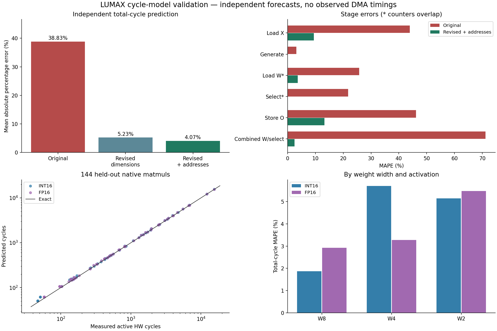

# Historical controller cycle model validation (2026-11-02)

This report describes an older controller/model revision, before the output-DMA and tagged-column changes. Its aggregate errors are not accuracy results for current Model.py/v4. See [current accuracy and scope](README.md).

Validated 2026-11-02 against the Chipyard 1.13.0 implementation at the structural-refactor baseline `bb35d2f`. This change updates the Python model and comparison integration. The accelerator Scala sources and `Linear-sw.c` kernel are unchanged; the starting Config.scala was restored byte-for-byte.

**144/144 held-out native hardware matmuls passed**, with **2,052/2,052 exact HW/Python output words**, C-reference checks and guard canaries. The revised independent total-cycle MAPE is **4.07%**, versus **38.83%** for the original formula on these same operations. This is a result for the coverage below, not a universal accuracy guarantee.



## Independent prediction results

All predictions below use dimensions, physical design settings and a declared memory profile. The address-aware prediction additionally uses input/weight/output symbol addresses from the ELF, available before simulation. **Neither independent prediction receives measured stage counters or DMA response timings.** MAPE averages each operation's absolute percentage error; WAPE weights errors by measured cycles. Accuracy within 10% is a fraction of operations, not `100 − MAPE`.

| Model | N | MAPE | WAPE | MAE cycles | Min/max absolute cycles | Min/max absolute % | Within ±10% |
| --- | --- | --- | --- | --- | --- | --- | --- |
| Original formula | 144 | 38.83% | 23.37% | 332.89 | 23.00 / 2,388.00 | 5.79% / 82.76% | 3.47% |
| Revised, dimensions only | 144 | 5.23% | 1.98% | 28.24 | 0 / 179 | 0.00% / 31.91% | 88.19% |
| Revised, actual ELF addresses | 144 | 4.07% | 1.70% | 24.17 | 0 / 179 | 0.00% / 21.57% | 90.97% |

## Stage errors

Only Load X + Generate + Combined Load W/Select + Store O sum to the active total. Load W-only and Select-only overlap; do not add them again. CPU setup, printing, boot and wall time are excluded. Core instruction-cycle counters remain separate.

| Stage | Original MAPE | Revised MAPE | Revised MAE cycles | Min/max absolute cycles | Max absolute % |
| --- | --- | --- | --- | --- | --- |
| Load X | 43.95% | 9.45% | 11.10 | 0 / 61 | 50.00% |
| Generate products | 3.20% | 0.00% | 0.00 | 0 / 0 | 0.00% |
| Load W alone (overlaps) | 25.70% | 3.66% | 16.76 | 0 / 141 | 53.85% |
| Select alone (overlaps) | 21.75% | 0.00% | 0.00 | 0 / 0 | 0.00% |
| Store output | 46.17% | 13.21% | 3.97 | 1 / 13 | 40.00% |
| Combined Load W/Select | 71.17% | 2.49% | 13.74 | 0 / 128 | 38.89% |

## Designs and formats

Each design/format group contains twelve matmuls, covering all four held-out dimensions and W8/W4/W2. Y_SLICE and DMA IDs vary between designs; this is not a full factorial sweep of every design/YS/ID combination.

| Design | Activation | Y_SLICE / IDs | N | MAPE | MAE cycles | Max absolute % |
| --- | --- | --- | --- | --- | --- | --- |
| b2_rf4 | FP16 | 1 / 2 | 12 | 2.82% | 18.75 | 7.04% |
| b2_rf4 | INT16 | 1 / 2 | 12 | 4.05% | 28.58 | 21.57% |
| b2_rf8 | FP16 | 2 / 6 | 12 | 2.21% | 8.08 | 6.90% |
| b2_rf8 | INT16 | 2 / 6 | 12 | 3.70% | 9.50 | 21.57% |
| b4_rf4 | FP16 | 1 / 1 | 12 | 4.14% | 47.58 | 10.39% |
| b4_rf4 | INT16 | 1 / 1 | 12 | 5.17% | 45.92 | 21.57% |
| b4_rf8 | FP16 | 2 / 2 | 12 | 5.15% | 32.83 | 11.51% |
| b4_rf8 | INT16 | 2 / 2 | 12 | 4.62% | 26.25 | 11.35% |
| b8_rf4 | FP16 | 1 / 2 | 12 | 4.87% | 31.50 | 11.59% |
| b8_rf4 | INT16 | 1 / 2 | 12 | 4.12% | 21.58 | 12.23% |
| b8_rf8 | FP16 | 2 / 6 | 12 | 4.16% | 10.83 | 11.46% |
| b8_rf8 | INT16 | 2 / 6 | 12 | 3.78% | 8.58 | 12.78% |

| Weights | Activation | N | MAPE | MAE cycles | Max absolute % |
| --- | --- | --- | --- | --- | --- |
| W2 | FP16 | 24 | 5.48% | 23.04 | 11.59% |
| W2 | INT16 | 24 | 5.15% | 15.04 | 21.57% |
| W4 | FP16 | 24 | 3.27% | 20.88 | 6.90% |
| W4 | INT16 | 24 | 5.71% | 29.71 | 12.78% |
| W8 | FP16 | 24 | 2.92% | 30.88 | 11.46% |
| W8 | INT16 | 24 | 1.87% | 25.46 | 3.88% |

## What was corrected

- The original formula forced the DMA latency to eight and did not honor the caller's HS setting. The new model exposes controller-visible hit latency, finite credits, next-edge ID reuse and ordered response spacing.
- A schedule of controller events replaces `(Cout-2) × max(loadW, select)`. It includes first-column fill, final drain, two weight buffers, overlap with LUT generation and producer/consumer stalls. Single-column output no longer produces negative phase estimates.
- Product generation takes `bank_span × (2^(w_bits−2)+1)` cycles per K window/row group. Selection takes `bank_span+5` per column. The two completion edges after the last weight DMA response are included.
- Activation reads clip at source beat and destination bank-word boundaries. Some source beats are intentionally reread. Packed weight transfers follow the same boundary rules with the actual weight precision.
- Y_SLICE rows generate/select in parallel and share each weight transfer. Extra row groups reload weights. Partial final row groups are masked.
- The model follows the current RTL's literal bank-span update. For example, b2/RF4/W8, K=17, M=3 uses spans 4/4/4 with Y_SLICE=1 (780 generation cycles), whereas Y_SLICE=2 uses 4/4/1 (585). This controller behavior is modeled, not changed in hardware.
- Store O waits for each acknowledgement even with multiple DMA IDs. Partial words at odd row boundaries can write the same beat twice. The previous model incorrectly treated stores as parallel DMA traffic.
- INT16 and FP16 have explicit format metadata. FP16 significand/alignment/final conversion are combinational in this RTL, so they add no controller stages. Equal cycles do not imply equal area, timing closure or maximum frequency.

## Verification method and evidence

Six b/RF designs were elaborated with make separately for INT16 and FP16, then their resulting Verilator binaries were reused for all three weight widths. Configurations were `(b,RF,YS,IDs) = (2,4,1,2), (2,8,2,6), (4,4,1,1), (4,8,2,2), (8,4,1,2), (8,8,2,6)`, with physical Rin=8/Cin=256/Cout=64. The held-out runtime dimensions `(R,K,M)` were `(1,2,1), (1,9,7), (3,31,5), (2,129,17)`.

Each RISC-V program calls the unchanged native preload and matmul helpers. Python creates independently seeded nontrivial signed weights and finite INT16/FP16 operands, computes its own exact reference, and checks actual returned output words. References are not copied into the accelerator output. The test C code independently calculates its reference after the hardware operation. Actual Config snapshots, simulator/ELF/C hashes, commands, seeds, operand hashes and every result are retained.

The model was developed using 27 separate traced cases before the 144-case schedule was frozen. Six further native matmuls through the actual GUI hardware-run function passed (both formats × W8/W4/W2), including real ELF symbol address extraction. All **62 software/API/controller-contract tests** pass; these are separate from hardware validation. The browser plot grouping and SVG generation checks also pass.

A read-only SystemVerilog bind monitor observed state and DMA interface handshakes; it drove no DUT signals. Main PC counters were cross-checked against state residency. Replaying only measured request-to-response DMA latencies reproduces **144/144 full six-counter stage vectors**. All request issue edges also match in **139/144** operations; remaining individual issue-edge differences at high concurrency do not alter the reported stage totals in this dataset. **This replay is a controller diagnostic and is excluded from independent accuracy statistics.**

The published source additionally marks issue-delay-only replay as diagnostic; re-evaluating every independent prediction with this final source produced identical cycle counts. The frozen validation source SHA is `f9318719bf8ba0543924af3d84ef01c583c62efd74a22ba776f26dd3749a4098`; the final source SHA is `40aff80c6f301f5f1f89c96781a443699141fe00e84431e7e622a1bb7cae8ca0`.

- [Native measurements and pre-run parameters](../../verification/logs/cycle_model/run_20261102_044611_527727/measurements.json)
- [Live-model GUI comparison, with all stage errors](../../verification/logs/cycle_model/run_20261102_044611_527727/comparison.json)
- [Commands and observed results](../../verification/logs/cycle_model/run_20261102_044611_527727/run.log)
- [Configuration snapshots, source hashes and aggregate metrics](../../verification/logs/cycle_model/run_20261102_044611_527727/summary.json)
- [Six actual GUI hardware checks](../../verification/logs/gui/run_20261102_051222_9700c2de/job.json)
- [External DMA observations for diagnostic replay only](../../verification/logs/cycle_model/run_20261102_044611_527727/dma_diagnostics.json)

## Memory assumptions and remaining error

The default `chipyard_llc` profile describes this current **magic-memory simulator without `+dramsim`**: HS=7 controller-visible hit cycles (including the ordered DMA response register), 64-byte lines, 512 KiB modeled capacity, read-miss increment 11 and write-miss increment 4. These are observed interface costs, not universal DRAM constants. The cache approximation uses a fully associative LRU, initially cold buffers and no CPU interference; it is not the actual set-associative LLC/CPU coherence implementation. Passing actual buffer addresses models beat offsets and line sharing. `memory_profile='uniform'` disables this cache approximation and uses the supplied HS for every response.

Unknown initial residency, CPU ownership/coherence probes, bus ready stalls, cache conflict/replacement details and concurrent memory traffic remain sources of error. Software integrity checks and reference loops can warm lines between sequential operations. There is no per-design fitted correction or measured-stage lookup table. Large cache-thrashing matrices, other memory backends and other clock/cache configurations require independent validation or adjusted memory parameters; this fresh run's largest native multiplication is X[2,129] × W[129,17]. Arithmetic/data-dependent numerical edge cases are covered by the separate FP16/row suites, not this timing dataset.

## Historical saved-suite cross-check

The same 4,168 valid archived native timings were also re-evaluated. On these older DMA/controller/memory conditions, MAPE changed from **34.28% to 10.91%**, WAPE from **17.61% to 17.05%**, and operations within 10% from **2.95% to 43.21%**. Generation and selection stage predictions are exact where those counters are available; memory-stage residuals remain. Load-X MAPE on archives increases from 21.36% to 24.66%, so the new profile is not an improvement for every stage/workload.

These archives include larger matrices and lack actual addresses/cache-state snapshots. They predate the ordered-response DMA fix and use the six-cycle direct-response hit setting. They are reported separately from current held-out accuracy. Missing counters, interrupted tests, timeouts and misaligned legacy TC11 counters remain excluded; no hardware results are invented.

## Use the live model

From the working generator root:

```bash
python3 -m unittest discover -s verification/tests -v
python3 verification/gui.py restart
```

Restart the existing GUI from a normal SSH terminal, then refresh the browser. The model source itself is reread on every comparison, but this update also changes the already-imported comparison/backend code. No active hardware job was stopped. A malformed temporary GUI test record stopped the old queue thread during validation; the record is corrected, and this restart restores the queue and loads the update. The tool sandbox could not open a listening socket, so it did not stop the existing dashboard process.

In **Cycle model**, select the new cycle-model validation run or any supported saved measurement, enable stage comparison and run the Python model. Group plots by activation, design, weights or stage. Diagnostic DMA replay is never included in the GUI accuracy numbers. Legacy models without declared FP16 support remain excluded for FP16.

```python
import importlib.util
spec = importlib.util.spec_from_file_location('lumax_model', 'Performance Modeling/Model.py')
model = importlib.util.module_from_spec(spec)
spec.loader.exec_module(model)
result = model.compute_cycles(Rin=2, Cin=129, Cout=17, in_bits=16, w_bits=4,
                              XS=8, factor=8, YS=2, ID=6, activation='fp16')
print(result['total_cycles'], result['cycles_load_X'], result['cycles_loadW_select'])
```

Use actual R/K/M and the elaborated b/RF/YS/ID values. Physical maximum capacities describe whether a native test fits; runtime dimensions drive controller cycles. Existing cycle-result keys remain compatible. Operation-count/energy estimates are not validated by this timing work. No Git commit or push was made for this task.
