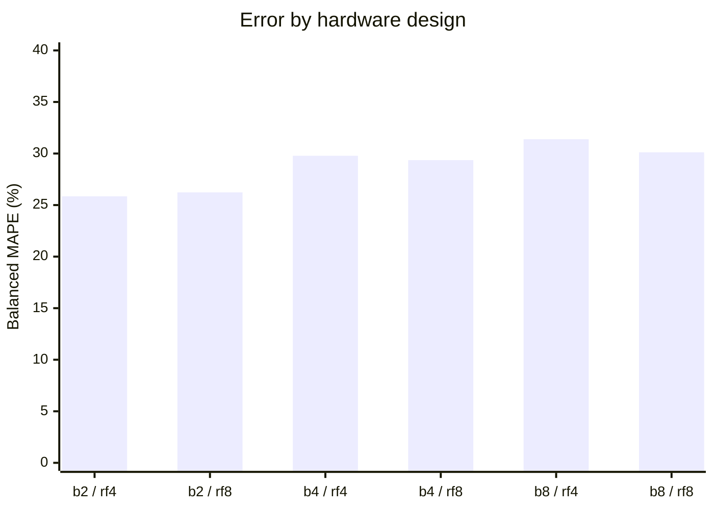
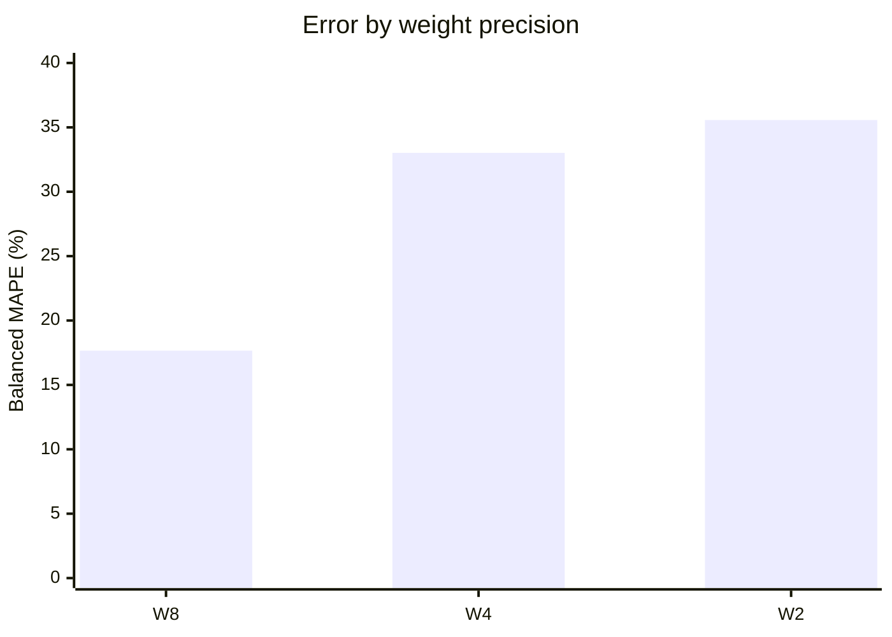
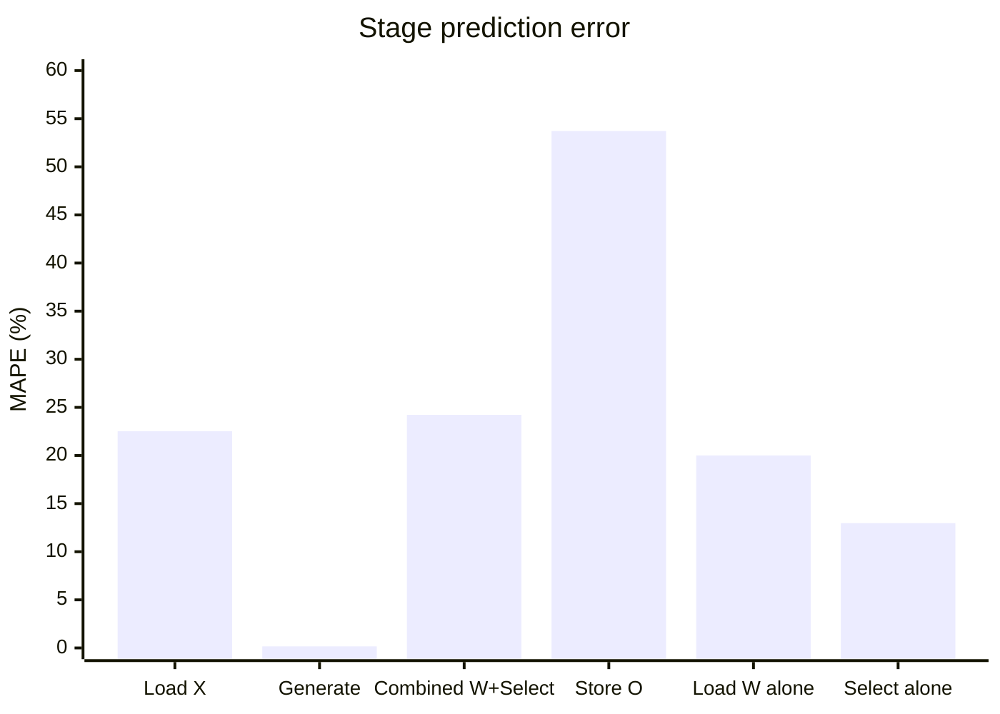

# Final LUMAX cycle-model accuracy report

This report compares the **unchanged Python analytical cycle model** with saved active-hardware cycle measurements from make-built Chipyard 1.13.0 Verilator runs. It covers the original regression, TC01–TC11, native 1024×1024 and the completed Llama2 suite. All included operations have numerical PASS results.

**Scope:** input16; W8/W4/W2; b=2/4/8; RF=4/8; YS=1. Generated 2026-10-21T22:44:49+03:00.

- **4,125 valid native timing observations**, representing **737 distinct workloads**.
- **34.53%** mean absolute percentage error per observation.
- **28.83%** workload-balanced mean absolute percentage error.
- **18.90%** cycle-weighted absolute error.
- **873.43 cycles** mean absolute error per observation.
- **441 observations** retain all stage counters. Stage statistics use this smaller, explicitly identified population.
- **150 requested operations are excluded** because their cycle records are missing, incomplete or unreliable; they are listed by category below.

The model generally underpredicts total cycles: aggregate signed bias is **-13.02%**. Median absolute percentage error is **40.62%**; **2.98%** of native predictions fall within ±10% of the measured total. These timing errors do not change the saved numerical PASS results.

No model equations, default timing constants, hardware or test programs were modified. No new Verilator simulations were launched for this comparison. Only this README is included in its Git commit.

## Metrics and measurement scope

For measured cycles `H` and model cycles `P`:

```text
Absolute error (cycles) = abs(P - H)
Absolute percentage error (APE) = 100 * abs(P - H) / H
MAE = mean(abs(P - H))
MAPE = mean(APE)
WAPE = 100 * sum(abs(P - H)) / sum(H)
Signed aggregate bias = 100 * sum(P - H) / sum(H)
```

**Lower absolute error is better.** Negative signed bias means underprediction. MAE is an error in cycles; MAPE and WAPE are errors in percent. `100 - MAPE` is not a pass rate or an accuracy probability.

The reference total is `Load X + Generate + combined Load W/Select + Store O`. The separate Load W and Select counters overlap; they are not extra additive stages. CPU `rdcycle` intervals, Python calculations, simulated CPU copies/printing, simulator startup and elapsed wall time are excluded.

TC08 contributes 2,592 observations but only 18 distinct design/precision/shape workloads. **Balanced MAPE** first averages APE within each workload, then averages the workloads with equal weight. The workload key is `(b, RF, top-level RTL revision, K, M, input bits, weight bits)`; seeds and data patterns are repeated observations of that workload. This prevents repeated TC08 shapes from dominating the balanced result.

Charts use self-contained Mermaid blocks; each chart's exact values also appear in a table. No separate plot assets are required. Markdown viewers without chart support still show all results in the tables. [GitHub chart-block documentation](https://docs.github.com/en/get-started/writing-on-github/working-with-advanced-formatting/creating-diagrams) and [Mermaid XY-chart syntax](https://mermaid.js.org/syntax/xyChart.html) describe the rendering format.

## 1. Error across verification suites

| Group | Measurements | Workloads | MAE (cycles) | MAPE | Balanced MAPE | WAPE |
|---|---|---|---|---|---|---|
| Regression180 | 180 | 180 | 1,493.47 | 22.51% | 22.51% | 8.47% |
| TC01–TC11 | 3,739 | 535 | 142.40 | 35.59% | 31.19% | 15.00% |
| Native1024 | 2 | 2 | 128,460.00 | 19.80% | 19.80% | 23.91% |
| Llama2 | 204 | 21 | 12,474.11 | 25.80% | 23.79% | 22.59% |


Native observations are counted once in global statistics. Llama2's 18 full-shape totals are aggregates of its 204 native observations and are not added a second time.

## 2. Error across hardware designs

| Group | Measurements | Workloads | MAE (cycles) | MAPE | Balanced MAPE | WAPE |
|---|---|---|---|---|---|---|
| b2_rf4 | 654 | 119 | 303.13 | 31.53% | 25.85% | 11.34% |
| b2_rf8 | 653 | 119 | 277.75 | 31.44% | 26.23% | 11.51% |
| b4_rf4 | 653 | 119 | 193.63 | 35.84% | 29.78% | 13.02% |
| b4_rf8 | 653 | 119 | 161.08 | 35.62% | 29.36% | 11.28% |
| b8_rf4 | 653 | 119 | 147.11 | 37.81% | 31.39% | 12.74% |
| b8_rf8 | 859 | 142 | 3,370.89 | 34.83% | 30.12% | 22.13% |




The rows do not have identical workload coverage. Only b8_rf8 has the completed Llama2 suite and native 1024 measurements. Other designs have the regression and available TC measurements. These are model-error summaries for the available data, not a controlled ranking of accelerator designs.

## 3. Error across weight precisions

| Group | Measurements | Workloads | MAE (cycles) | MAPE | Balanced MAPE | WAPE |
|---|---|---|---|---|---|---|
| W8 | 1,372 | 242 | 849.09 | 19.09% | 17.66% | 12.69% |
| W4 | 1,377 | 248 | 1,109.75 | 40.96% | 33.02% | 25.29% |
| W2 | 1,376 | 247 | 661.21 | 43.48% | 35.57% | 23.69% |




Input precision stays at 16 bits in all three groups. W8 predictions have smaller relative errors than W4/W2 in this dataset; neither the model nor its constants were tuned for a precision.

### Every design and weight-precision combination

| Group | Measurements | Workloads | MAE (cycles) | MAPE | Balanced MAPE | WAPE |
|---|---|---|---|---|---|---|
| b2_rf4 / W8 | 218 | 39 | 540.60 | 14.90% | 15.14% | 13.98% |
| b2_rf4 / W4 | 218 | 40 | 202.90 | 38.06% | 29.50% | 9.45% |
| b2_rf4 / W2 | 218 | 40 | 165.89 | 41.63% | 32.63% | 8.28% |
| b2_rf8 / W8 | 217 | 39 | 489.15 | 14.49% | 15.81% | 15.51% |
| b2_rf8 / W4 | 218 | 40 | 179.39 | 38.13% | 29.98% | 8.61% |
| b2_rf8 / W2 | 218 | 40 | 165.69 | 41.63% | 32.63% | 8.27% |
| b4_rf4 / W8 | 217 | 39 | 262.91 | 19.31% | 18.18% | 12.47% |
| b4_rf4 / W4 | 218 | 40 | 174.49 | 43.19% | 34.85% | 14.36% |
| b4_rf4 / W2 | 218 | 40 | 143.81 | 44.94% | 36.03% | 12.59% |
| b4_rf8 / W8 | 217 | 39 | 182.50 | 18.63% | 16.68% | 9.31% |
| b4_rf8 / W4 | 218 | 40 | 157.01 | 43.22% | 35.04% | 13.28% |
| b4_rf8 / W2 | 218 | 40 | 143.81 | 44.94% | 36.04% | 12.59% |
| b8_rf4 / W8 | 217 | 39 | 176.18 | 25.07% | 20.34% | 10.49% |
| b8_rf4 / W4 | 218 | 40 | 129.12 | 42.84% | 35.01% | 12.17% |
| b8_rf4 / W2 | 218 | 40 | 136.15 | 45.47% | 38.54% | 18.74% |
| b8_rf8 / W8 | 286 | 47 | 2,818.44 | 21.44% | 19.46% | 12.59% |
| b8_rf8 / W4 | 287 | 48 | 4,684.21 | 40.48% | 33.59% | 30.79% |
| b8_rf8 / W2 | 286 | 47 | 2,605.43 | 42.54% | 37.25% | 32.24% |


## 4. Absolute error across hardware stages

All six comparisons below use **441** observations retaining the four main counters and the separate overlapping Load W/Select counters: 180 regression + one surviving TC01 + 54 TC02 + two native 1024 + 204 Llama2 observations. They do not represent stage coverage for all 4,125 total-cycle records.

| Stage | N | HW cycles sum | Model cycles sum | MAE (cycles) | MAPE | WAPE | Signed bias |
|---|---|---|---|---|---|---|---|
| Load X | 441 | 88,273 | 87,734 | 24.06 | 22.52% | 12.02% | -0.61% |
| Generate products | 441 | 368,013 | 368,403 | 0.88 | 0.16% | 0.11% | +0.11% |
| Combined Load W/Select | 441 | 14,598,558 | 12,883,170 | 6,734.98 | 24.22% | 20.35% | -11.75% |
| Store output | 441 | 504,705 | 245,889 | 586.88 | 53.72% | 51.28% | -51.28% |
| Load W alone (overlapping) | 441 | 13,877,616 | 12,338,164 | 6,572.32 | 20.01% | 20.89% | -11.09% |
| Select alone (overlapping) | 441 | 7,854,084 | 7,080,804 | 1,753.47 | 12.97% | 9.85% | -9.85% |




Product generation is close to the recorded hardware counters. Store output is the largest average stage mismatch, with a strong underprediction. This identifies where the model differs; it does not establish a code change or a calibrated correction.

**Overlap warning:** the model's Load W-only and Select-only estimates are compared with the corresponding hardware activity counters as diagnostics. Do not add them to each other or to combined Load W/Select. Only the four main phases form the reported total.

### Stage MAPE by weight precision

| Weights | N | Load X | Generate products | Combined Load W/Select | Store output | Load W alone (overlapping) | Select alone (overlapping) |
|---|---|---|---|---|---|---|---|
| W8 | 148 | 22.26% | 0.46% | 18.65% | 53.78% | 15.07% | 18.63% |
| W4 | 147 | 19.86% | 0.00% | 27.40% | 53.53% | 23.32% | 10.10% |
| W2 | 146 | 25.46% | 0.00% | 26.66% | 53.85% | 21.69% | 10.12% |


### Stage MAPE for every design and weight precision

Every percentage is the mean absolute percentage error over that row's stage observations.

| Design / weights | N | Load X | Generate products | Combined Load W/Select | Store output | Load W alone (overlapping) | Select alone (overlapping) |
|---|---|---|---|---|---|---|---|
| b2_rf4 / W8 | 14 | 34.10% | 2.38% | 29.46% | 56.80% | 16.39% | 22.43% |
| b2_rf4 / W4 | 13 | 34.16% | 0.00% | 19.58% | 55.37% | 16.19% | 10.19% |
| b2_rf4 / W2 | 13 | 39.32% | 0.00% | 19.14% | 55.89% | 13.13% | 9.92% |
| b2_rf8 / W8 | 13 | 29.88% | 1.10% | 30.81% | 55.68% | 19.27% | 16.60% |
| b2_rf8 / W4 | 13 | 34.47% | 0.00% | 19.37% | 55.28% | 16.51% | 9.98% |
| b2_rf8 / W2 | 13 | 39.62% | 0.00% | 19.14% | 55.82% | 13.07% | 9.92% |
| b4_rf4 / W8 | 13 | 29.72% | 1.10% | 24.69% | 55.71% | 19.42% | 23.43% |
| b4_rf4 / W4 | 13 | 34.62% | 0.00% | 25.25% | 55.32% | 14.99% | 14.37% |
| b4_rf4 / W2 | 13 | 39.23% | 0.00% | 21.18% | 55.82% | 12.95% | 14.26% |
| b4_rf8 / W8 | 13 | 32.36% | 0.51% | 19.45% | 55.61% | 15.30% | 18.88% |
| b4_rf8 / W4 | 13 | 34.75% | 0.00% | 25.05% | 55.31% | 15.15% | 14.26% |
| b4_rf8 / W2 | 13 | 39.23% | 0.00% | 21.18% | 55.82% | 12.95% | 14.26% |
| b8_rf4 / W8 | 13 | 30.53% | 0.00% | 18.41% | 55.66% | 15.16% | 24.91% |
| b8_rf4 / W4 | 13 | 32.86% | 0.00% | 24.45% | 55.28% | 15.14% | 18.60% |
| b8_rf4 / W2 | 13 | 37.25% | 0.00% | 25.13% | 55.81% | 12.66% | 18.60% |
| b8_rf8 / W8 | 82 | 14.94% | 0.00% | 13.83% | 52.07% | 13.45% | 16.51% |
| b8_rf8 / W4 | 82 | 8.51% | 0.00% | 31.10% | 52.12% | 29.44% | 7.43% |
| b8_rf8 / W2 | 81 | 14.66% | 0.00% | 31.08% | 52.27% | 28.69% | 7.50% |


### Stage MAE in cycles for every design and weight precision

These are absolute errors in cycles, not percentages. Larger workloads can have larger cycle MAE even when their percentage error is smaller.

| Design / weights | N | Load X | Generate products | Combined Load W/Select | Store output | Load W alone (overlapping) | Select alone (overlapping) |
|---|---|---|---|---|---|---|---|
| b2_rf4 / W8 | 14 | 28.86 | 9.29 | 4,762.21 | 168.36 | 1,588.71 | 6,370.86 |
| b2_rf4 / W4 | 13 | 23.62 | 0.00 | 565.92 | 176.00 | 320.31 | 450.46 |
| b2_rf4 / W2 | 13 | 30.15 | 0.00 | 283.85 | 177.46 | 292.23 | 174.77 |
| b2_rf8 / W8 | 13 | 19.46 | 10.00 | 4,555.54 | 182.00 | 1,737.77 | 3,427.08 |
| b2_rf8 / W4 | 13 | 23.85 | 0.00 | 367.38 | 172.85 | 432.77 | 253.54 |
| b2_rf8 / W2 | 13 | 31.31 | 0.00 | 283.85 | 175.46 | 287.92 | 174.77 |
| b4_rf4 / W8 | 13 | 19.62 | 5.00 | 1,882.31 | 180.54 | 1,787.00 | 3,429.85 |
| b4_rf4 / W4 | 13 | 24.85 | 0.00 | 435.31 | 174.31 | 421.85 | 253.54 |
| b4_rf4 / W2 | 13 | 30.15 | 0.00 | 234.15 | 176.69 | 289.31 | 174.77 |
| b4_rf8 / W8 | 13 | 18.92 | 5.00 | 1,066.23 | 180.15 | 1,060.15 | 1,719.08 |
| b4_rf8 / W4 | 13 | 25.38 | 0.00 | 287.92 | 174.00 | 518.77 | 174.77 |
| b4_rf8 / W2 | 13 | 30.15 | 0.00 | 234.15 | 176.69 | 289.31 | 174.77 |
| b8_rf4 / W8 | 13 | 18.15 | 0.00 | 1,061.92 | 180.23 | 1,060.69 | 1,720.00 |
| b8_rf4 / W4 | 13 | 22.85 | 0.00 | 517.62 | 173.46 | 523.46 | 174.77 |
| b8_rf4 / W2 | 13 | 27.31 | 0.00 | 229.00 | 176.69 | 285.46 | 174.77 |
| b8_rf8 / W8 | 82 | 32.56 | 0.00 | 10,341.23 | 916.16 | 10,453.12 | 4,654.44 |
| b8_rf8 / W4 | 82 | 12.18 | 0.00 | 15,252.15 | 921.72 | 15,247.18 | 867.51 |
| b8_rf8 / W2 | 81 | 25.22 | 0.00 | 8,009.05 | 908.12 | 7,996.72 | 852.94 |


## 5. Full Llama2 matmuls: exact tile-summed predictions

The completed run used b8_rf8, input16 and T=16. All 18 logical cases and 204 native operations passed. LQ04 used **62 tiles of 288×512 weights plus one tile of 288×256**. The other shapes each used one native operation.

For this comparison, the original model is evaluated on each actual tile's dimensions and the predictions are summed. This includes the smaller final tile; it is not the newer GUI fast-mode approximation. A single `Cout=32000` model call would describe a different, untiled invocation and is not used for the error figures here.

| Shape | Logical X · W | Weights | Tiles | Measured cycles | Model tile sum | Absolute error (cycles) | APE |
|---|---|---|---|---|---|---|---|
| LQ01 | 1×288 · 288×288 | W8 | 1 | 44,601 | 50,692 | 6,091 | 13.66% |
| LQ01 | 1×288 · 288×288 | W4 | 1 | 33,245 | 21,924 | 11,321 | 34.05% |
| LQ01 | 1×288 · 288×288 | W2 | 1 | 18,585 | 12,378 | 6,207 | 33.40% |
| LQ02 | 1×288 · 288×768 | W8 | 1 | 122,830 | 130,852 | 8,022 | 6.53% |
| LQ02 | 1×288 · 288×768 | W4 | 1 | 88,029 | 57,924 | 30,105 | 34.20% |
| LQ02 | 1×288 · 288×768 | W2 | 1 | 48,178 | 32,538 | 15,640 | 32.46% |
| LQ03 | 1×768 · 768×288 | W8 | 1 | 124,947 | 120,853 | 4,094 | 3.28% |
| LQ03 | 1×768 · 768×288 | W4 | 1 | 54,210 | 57,024 | 2,814 | 5.19% |
| LQ03 | 1×768 · 768×288 | W2 | 1 | 31,417 | 29,852 | 1,565 | 4.98% |
| LQ04 | 1×288 · 288×32,000 | W8 | 63 | 4,981,673 | 5,507,548 | 525,875 | 10.56% |
| LQ04 | 1×288 · 288×32,000 | W4 | 63 | 3,660,520 | 2,420,412 | 1,240,108 | 33.88% |
| LQ04 | 1×288 · 288×32,000 | W2 | 63 | 2,053,538 | 1,361,766 | 691,772 | 33.69% |
| LQ05 | 1×48 · 48×16 | W8 | 1 | 1,000 | 822 | 178 | 17.80% |
| LQ05 | 1×48 · 48×16 | W4 | 1 | 484 | 336 | 148 | 30.58% |
| LQ05 | 1×48 · 48×16 | W2 | 1 | 389 | 220 | 169 | 43.44% |
| LQ06 | 1×16 · 16×48 | W8 | 1 | 891 | 658 | 233 | 26.15% |
| LQ06 | 1×16 · 16×48 | W4 | 1 | 687 | 492 | 195 | 28.38% |
| LQ06 | 1×16 · 16×48 | W2 | 1 | 668 | 486 | 182 | 27.25% |


## 6. Detailed TC timing coverage

| Group | Measurements | Workloads | MAE (cycles) | MAPE | Balanced MAPE | WAPE |
|---|---|---|---|---|---|---|
| TC01 | 1 | 1 | 64.00 | 28.19% | 28.19% | 28.19% |
| TC02 | 54 | 54 | 193.19 | 28.19% | 28.19% | 22.88% |
| TC03 | 72 | 72 | 867.85 | 20.55% | 20.55% | 15.96% |
| TC04 | 216 | 216 | 126.50 | 34.93% | 34.93% | 25.09% |
| TC05 | 162 | 162 | 98.12 | 38.29% | 38.29% | 30.77% |
| TC06 | 54 | 18 | 89.44 | 37.57% | 37.57% | 30.58% |
| TC07 | 180 | 36 | 226.67 | 29.77% | 29.77% | 15.43% |
| TC08 | 2,592 | 18 | 89.27 | 37.52% | 37.52% | 30.54% |
| TC09 | 360 | 36 | 176.30 | 30.07% | 30.07% | 23.79% |
| TC10 | 30 | 30 | 2,469.90 | 5.09% | 5.09% | 4.51% |
| TC11 | 18 | 18 | 91.89 | 38.14% | 38.14% | 31.15% |


The original TC suite records 3,792 passing boots and six timeouts. TC11 contains six operations per boot. Correctness PASS does not guarantee a usable counter record: timing coverage is evaluated separately.

## 7. Excluded or unavailable cycle measurements

| Source | Excluded operations | Reason |
|---|---:|---|
| TC01 | 53 | The original detailed cycle blocks are unavailable; only one recorded full case survives. |
| TC10 | 6 | Simulator timeouts have no completed cycle measurements. |
| TC11 steps 2–5 | 72 | The counter selector is misaligned and reports zero. |
| TC11 step 6 | 18 | The selector reads the wrong counters; a positive value is not a valid total. |
| Native 1024 W2 | 1 | Simulation was launched, but there is no saved final result/cycle measurement. |
| **Total** | **150** | **Not filled with estimates and not included in error metrics.** |

TC11 step 1 is retained for each of its 18 fresh Verilator boots because the selector starts aligned; later steps are excluded. For native 1024, only W8 and W4 have completed records. Earlier superseded/interrupted Llama2 attempts, unrelated GUI custom tests, failed builds and extrapolated fast-mode values are outside these four canonical datasets.

## 8. Model assumptions and reproducibility

The same parameters are matched for every included native operation:

```python
compute_cycles(
    Rin=1, Cin=actual_K, Cout=actual_M,
    in_bits=16, w_bits=actual_weight_bits,
    XS=actual_b, YS=1, ID=2,
    buffers_w=2, factor=actual_RF, DMA_WIDTH=64,
    IN_MAX=16, IN_min=8, W_MAX=8, HS=8,
)
```

`XS` maps to b; `factor` maps to RF. The saved configurations use two outstanding DMA requests and a 64-bit DMA bus. The model itself forces HS=8, uses `(Cout - 2)` for the combined weight/select term and repeats uniform activation-window costs even for a shorter tail window. Its cache/buffer-control arguments do not alter those formulas. These are existing assumptions, not changes introduced for this report.

Only the two original function ASTs were evaluated, unchanged, with the standard `math` module. Unused plotting/widget imports were omitted from evaluation. No function body, equation, timing constant or fitted multiplier was changed. The documented 1×64 × 64×64, b2/RF8/W4 example reproduces **2,524 model cycles**.

Two top-level RTL revisions occur in the saved records:

- Original regression and TC01: `6bafd90926b9490d95fe8e1481631b769aef013263cdd20cb17733987e532111`.
- TC02 onward, native 1024 and completed Llama2: `1404c50d8e37ee3d7a4967bdc95e653190cbe880bf702e1873534aba3f38434c`.

Revision is included in the balanced-workload key. Cross-design summaries aggregate the available revisions and workload populations; they should not be interpreted as matched performance benchmarks.

### Sources and hashes

The following links target files already present in this repository. The report does not depend on an uncommitted HTML file or external image assets.


| Input file | SHA-256 |
|---|---|
| [Original Python model](../Model.py) | 19a96da1622d43150f4b86eddd11572e2bc287f28f973b2f4991e65035bb418d |
| [verification/logs/llama_shapes/run_20261018_201948_372793.log](../../verification/logs/llama_shapes/run_20261018_201948_372793.log) | cced00f7727203b430d7d2ffaccb0521c434a0219e13f2ddbce5c41b71fc85e7 |
| [verification/logs/matrix_1024/run_20261018_144440_914146.log](../../verification/logs/matrix_1024/run_20261018_144440_914146.log) | fbc2c6cd142b9d155e5d9678fe7fb5a3bb24c3c8be0d8171781ece256c8d5c67 |
| [verification/logs/regression/run_20261008_193240/total_results.csv](../../verification/logs/regression/run_20261008_193240/total_results.csv) | e7d65f2b6cce5a5c9e5867361d4e8aa1c510c5962e1a1fad90e5674eb25b8a0c |
| [verification/logs/test_cases/run_20261009/Log_TC01.log](../../verification/logs/test_cases/run_20261009/Log_TC01.log) | 84f4a0cdcc86e1c4b22e4225eda9cdd05d09e5479a732254fb46d847a7d82110 |
| [verification/logs/test_cases/run_20261009/Log_TC02.log](../../verification/logs/test_cases/run_20261009/Log_TC02.log) | cad72fe82577006cdcfa82cfbb5178d51fd24e9cef9ea890925ac76dcb2c0e85 |
| [verification/logs/test_cases/run_20261009/Log_TC03.log](../../verification/logs/test_cases/run_20261009/Log_TC03.log) | a747d3f0ed45f261d93decc0d98368e67b930f3be37c5977c89d0a8915332382 |
| [verification/logs/test_cases/run_20261009/Log_TC04.log](../../verification/logs/test_cases/run_20261009/Log_TC04.log) | 0260938ecf9ca5e834c41407f95a8761c644238e766edc7129a9fb038a210c81 |
| [verification/logs/test_cases/run_20261009/Log_TC05.log](../../verification/logs/test_cases/run_20261009/Log_TC05.log) | c556643aa2192bb1c9a62685b184b801bff81908610ad2431b82800bd6f0644f |
| [verification/logs/test_cases/run_20261009/Log_TC06.log](../../verification/logs/test_cases/run_20261009/Log_TC06.log) | 2a0f42158335ffc0b677b6f958f6f1bd845486d18536f39f7180478ecd0543bd |
| [verification/logs/test_cases/run_20261009/Log_TC07.log](../../verification/logs/test_cases/run_20261009/Log_TC07.log) | 34c0bc6a0752e0d35f6d50dd81456eacc9d7ef31ed0736297530908b099dcec3 |
| [verification/logs/test_cases/run_20261009/Log_TC08.log](../../verification/logs/test_cases/run_20261009/Log_TC08.log) | 050167ece43c1a163e0b2f839a2484bdd36ce22ac15565ae939a08bf905dec1a |
| [verification/logs/test_cases/run_20261009/Log_TC09.log](../../verification/logs/test_cases/run_20261009/Log_TC09.log) | c3d6b7457e86368acf0def880310c3f4ac2329d428efc5fbc9b25975f1db0059 |
| [verification/logs/test_cases/run_20261009/Log_TC10.log](../../verification/logs/test_cases/run_20261009/Log_TC10.log) | e2d85a3a48c293404ad877c3b59f495d5c440a07a75cff19344dbfb12852e01e |
| [verification/logs/test_cases/run_20261009/Log_TC11.log](../../verification/logs/test_cases/run_20261009/Log_TC11.log) | dce0689b2a9cbe1b91d3724b932d5abb24740fc04d1ef8d600c468c19ff97c09 |


The aggregated input contains **4,125 unique `(suite, case/operation)` records**. Its canonical JSON SHA-256 is `914a242f7ad8350e33029c0dc93ff717fd52144984e70317b48f1c637926f675`. Total and stage errors were independently recomputed from the stored measured/predicted pairs; the four stage sums were checked against saved active-cycle totals wherever available. TC03–TC11 run-block cycle arrays were cross-checked against their saved summary rows. Llama2 tile counts and cycle sums match all 18 saved full-shape results.

The original model file SHA-256 remained `19a96da1622d43150f4b86eddd11572e2bc287f28f973b2f4991e65035bb418d` before and after analysis. This README records the original model's observed errors; it does not claim the excluded cases passed timing validation or that all designs share identical workload coverage.
