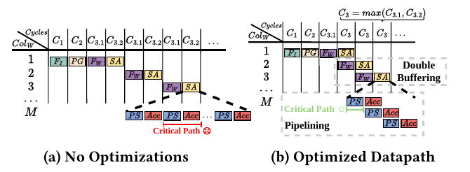

# Performance model

[Project overview](../README.md) · [Architecture](../LUMAX/README.md) · [Measurements](../LUMAX/software/tests/README.md)

[Model.py](Model.py), version `controller-events-v4`, predicts active accelerator cycles for INT16 or FP16 activations and signed W8/W4/W2 weights. The equations below describe its controller and memory scheduling so that the model can be understood and evaluated without reading Python. All times are integer cycle edges.

The model returns four additive stages: input loading, product generation, combined weight loading/selection, and output storage. CPU preparation, software reference calculations, printing, simulator startup, and wall-clock time are outside this total. FP16 significand handling, alignment, and FP32 conversion are combinational in the modeled RTL: they affect area and achievable frequency, but do not add controller cycles.

## Parameters and supported configurations

For the matrix multiplication

```math
O_{N\times M}=X_{N\times K}W_{K\times M},
```

use the following symbols. Defaults here are defaults of `compute_cycles`, not necessarily the current hardware configuration.

| Symbol | Meaning | Python argument | Default |
|---|---|---|---|
| $N,K,M$ | Input rows, reduction dimension, output columns | Rin, Cin, Cout | Required |
| $b$ | Activation banks per parallel row | XS | Required |
| $Y$ | Maximum parallel activation rows | YS | Required |
| $RF$ | Product-memory row factor; each bank has $64RF$ product rows | factor | 4 |
| $w$ | Signed weight precision | w_bits | Required: 2, 4, or 8 |
| $D$ | Outstanding DMA request slots for reads | ID | Required |
| $B$ | Weight-buffer count | buffers_w | 2 |
| $H$ | Accepted-request to controller-visible cache-hit response latency | HS | 7 |
| $\delta$ | Delay before weight prefetch starts | extra_prefetch_cycles | 0 |

The current implementation requires `in_bits=16`, `IN_MAX=16`, `W_MAX=8`, and `DMA_WIDTH=64`. Select `activation='int16'` or `'fp16'`; outputs occupy 32 bits in either case. Dimensions, bank counts, row factor, buffer count, request count, and hit latency must be positive integers. Hardware geometry must match the simulated or implemented design.

`cache_8_4`, `cache_reads`, and `IN_min` are compatibility arguments and do not change this input16 model. The model does not currently accept 8-bit activations or a 128-bit DMA interface.

## 1. Activation capacity, windows, and parallel rows

The number of activations whose products fit in one bank is

```math
\boxed{A=RF\,2^{8-w}}.
```

The default activation-window size is $V=bA$. An optional positive `block_size` replaces $V$, with $V\le bA$. The number of K windows per row group and the number of row groups are

```math
J=\left\lceil\frac K V\right\rceil,
\qquad Q=\left\lceil\frac N Y\right\rceil.
```

For zero-based row group $g=0,\ldots,Q-1$ and window $j=0,\ldots,J-1$,

```math
a_g=\min(Y,N-gY),
\qquad L_j=\min(V,K-jV).
```

Thus $a_g$ rows are active and $L_j$ activations are loaded per row. `Repeat activation Window` is $QJ$, counting row-group windows rather than individual rows.

Each row group starts with bank span

```math
G_0=\min\left(A,\left\lceil\frac{\min(K,V)}b\right\rceil\right).
```

The bank span is the number of activation positions processed per bank. Before a subsequent window, the current controller/model updates it as

```math
G_{j+1}=\begin{cases}
\displaystyle\min\left(G_j,\left\lceil\frac{K-bG_j}{b}\right\rceil\right),&Y=1,\\[6pt]
\displaystyle\min\left(G_j,\left\lceil\frac{\min(V,K-(j+1)V)}b\right\rceil\right),&Y>1.
\end{cases}
```

The $Y=1$ branch intentionally uses $K-bG_j$, matching the current RTL. With three or more windows, the final bank span can therefore remain padded even though the actual payload $L_j$ is shorter. Reset $G$ to $G_0$ for every new row group.

## 2. DMA requests and memory response timing

DMA uses 64-bit (8-byte) requests. Input rows and weight columns are packed contiguously; weights are stored in the transposed, column-contiguous layout prepared by the host software. Default byte addresses are `x_address=0x10000000`, `w_address=0x20000000`, and `o_address=0x30000000`. Supplied base addresses must be nonnegative and 8-byte aligned.

### Constructing the read requests

For a read of $L$ elements of precision $q$, starting at source-element index $s$, let $u=0$ be the number already consumed, and let $G$ be the current bank span. Define

```math
p=\frac{64}{q},\qquad v=u\bmod G,
\qquad c=\min\left(L-u,\ p-((s+u)\bmod p)\right).
```

If $p-(v\bmod p)<G-v$, also apply

```math
c\leftarrow\min\left(c,\ p-(v\bmod p)\right).
```

Issue a read of the beat at byte address

```math
\boxed{\mathrm{address}=\mathrm{base}+8\left\lfloor\frac{s+u}{p}\right\rfloor},
```

consume $c$ elements, and repeat with $u\leftarrow u+c$ until $u=L$. The destination bank-word boundaries can cause a source beat to be read more than once; retaining these requests matters for exact timing and cache behavior.

For activation row $r$, use $q=16$, $s=rK+jV$, and the X base address. For zero-based output column $m$, use $q=w$, $s=mK+jV$, and the W base address. Both use $L=L_j$ and $G=G_j$.

For aligned transfers without repeated reads, the simpler request counts are

```math
n_X=\left\lceil\frac{16L_j}{64}\right\rceil,
\qquad n_W=\left\lceil\frac{wL_j}{64}\right\rceil.
```

### Scheduling a transfer

Let a transfer start at absolute cycle $t$. For its requests $i=1,\ldots,n$, define issue cycles $s_i$, memory-ready cycles $r_i$, and ordered delivery cycles $d_i$. Set $s_0=t-1$. With $D$ request slots,

```math
\boxed{s_i=\begin{cases}
\max(s_{i-1}+1,t),&i\le D,\\[0pt]
\max(s_{i-1}+1,d_{i-D}+1),&i>D.
\end{cases}}
```

Only one request is issued per cycle, and a released slot becomes reusable on the next cycle. Responses are delivered in request order, at most one per cycle:

```math
\boxed{d_1=r_1,\qquad d_i=\max(r_i,d_{i-1}+1)\quad(i>1)}.
```

The transfer duration is measured from its starting edge to its last delivery edge:

```math
\boxed{\mathcal T=d_n-t}.
```

Controller completion cycles are added separately in the stage equations below. All stage payloads are nonempty for supported positive dimensions.

### Uniform memory profile

For `memory_profile='uniform'`, every request has fixed response latency:

```math
r_i=s_i+H.
```

### Default LLC memory profile

For `memory_profile='chipyard_llc'`, maintain a cache of lines with a stored ready cycle $F_\ell$. The line number is

```math
\ell=\left\lfloor\frac{\mathrm{address}}{L_{\mathrm{cache}}}\right\rfloor.
```

On a miss, allocate the line and set

```math
F_\ell=s_i+H+P,
\qquad P=\begin{cases}P_R,&\text{read},\\P_W,&\text{write}.\end{cases}
```

For both hits and misses,

```math
\boxed{r_i=\max(s_i+H,F_\ell)}.
```

This lets requests to the same not-yet-ready line share its outstanding fill delay. Hits retain the line's stored ready cycle. Every access updates LRU order; a miss evicts the least recently used line if capacity is exhausted. The number of cache lines is $\max(1,\lfloor C_{\mathrm{cache}}/L_{\mathrm{cache}}\rfloor)$.

| Memory parameter | Python argument | Default |
|---|---|---:|
| Cache-line bytes $L_{\mathrm{cache}}$ | cache_line_bytes | 64 |
| Cache capacity bytes $C_{\mathrm{cache}}$ | cache_bytes | 524,288 |
| Additional read-miss cycles $P_R$ | read_miss_penalty | 11 |
| Additional write-miss cycles $P_W$ | write_miss_penalty | 4 |

The cache starts empty for each `compute_cycles` call and persists across that call's stages, windows, and row groups. Evaluate row groups in order; within each group, evaluate each window's X reads followed by W columns in order, then store outputs after the final window. Use the absolute issue cycles from the scheduling equations, including weight prefetch during product generation.

This memory profile assumes cold buffers, no CPU interference, and the configured cache geometry and miss costs. Actual addresses, cache ownership, and concurrent CPU traffic can change hardware timings.

## 3. Input loading

Within row group $g$ and window $j$, load active rows sequentially. Start each row's transfer at the cycle reached by the previous row. If its DMA duration is $\mathcal T_{X,g,j,r}$,

```math
\boxed{C_{X,g,j}=\sum_{r=gY}^{gY+a_g-1}\left(\mathcal T_{X,g,j,r}+2\right)+1}.
```

The two cycles per row account for response/row completion; the final cycle changes controller state. The actual payload is $L_j$ per row, including a shorter tail window.

## 4. Product generation

There are $2^{w-2}$ positive even product rows per activation. Product generation takes

```math
\boxed{C_{\mathrm{PG},g,j}=G_j\left(2^{w-2}+1\right)}.
```

Parallel activation rows generate their tables concurrently, so this cost is not multiplied by $a_g$. Weight prefetch can start at the beginning of this stage.

## 5. Weight loading, selection, and buffer overlap

The controller carries a valid bit, output-column tag and last-input flag through four registers. It advances the input column after its last selection step, while older tagged results continue accumulating. Selection and weight loading share the existing buffers and memory ports.

For bank span $G_j$, a column issues $G_j$ selection inputs. Its occupied interval, if isolated, lasts $G_j+4$ cycles. The next column can issue immediately after those $G_j$ inputs; it does not wait for the four-cycle tail. A consumed weight buffer becomes available one cycle after the final input edge reaches stage 2.

Let $t_0$ be the absolute product-generation start cycle. For one-based columns $c=1,\ldots,M$, define weight-load start $u_c$, buffer-ready time $f_c$, selection-input start $a_c$, input-end edge $h_c$, buffer-release edge $q_c$, and retirement-end edge $e_c$. Initialize

```math
f_0=t_0+\delta,\qquad h_0=t_0+C_{\mathrm{PG},g,j}.
```

The producer may reuse a buffer after its previous column's final weight read is captured:

```math
\boxed{u_c=\begin{cases}
\max(f_{c-1},t_0),&c\le B,\\[0pt]
\max(f_{c-1},q_{c-B}),&c>B.
\end{cases}}
```

Construct W requests for zero-based column $m=c-1$, start at $u_c$, and calculate transfer duration $\mathcal T_{W,c}$ using $D$ slots. Then

```math
\boxed{f_c=u_c+\mathcal T_{W,c}+2},\qquad
\boxed{a_c=\max(h_{c-1},f_c)},
```

```math
\boxed{h_c=a_c+G_j},\qquad
\boxed{q_c=h_c+1},\qquad
\boxed{e_c=h_c+4}.
```

The two edges after the last DMA delivery make the buffer ready. Selection inputs wait for weights and the previous column's last input, while tagged accumulation tails overlap. After the final input, the controller drains its four valid/tag stages. The last valid contribution writes O_reg on the same transition edge that ends the combined state; no additional Done_acc/w_idx handoff cycle is added.

The combined stage reported after product generation is

```math
\boxed{C_{\mathrm{WS},g,j}=e_M-\left(t_0+C_{\mathrm{PG},g,j}\right)}.
```

The standalone selection counter counts the union of occupied intervals $[a_c,e_c)$, avoiding double-counting overlapping tails. With no weight stalls, this is $MG_j+4$, rather than $M(G_j+5)$ in v3. Subtracting generation in the combined-stage equation avoids counting hidden weight-prefetch time twice. All columns are processed, including $M=1$ or $2$.



*Manuscript Figure 3 illustrates the overlap. The current controller equations above include its explicit scheduling costs.*

## 6. Output storage

Store outputs once per row group, after all its K windows. Each beat holds up to two 32-bit outputs. For global zero-based row $r$, the number of writes is

```math
n_{O,r}=\left\lceil\frac{M+((rM)\bmod2)}2\right\rceil.
```

For exact addresses and partial beats, start with $z=0$ outputs written. Each request writes $\min(M-z,2-((rM+z)\bmod2))$ outputs to `o_address` plus $8\lfloor(rM+z)/2\rfloor$ bytes; advance $z$ by that count.

All writes in the active row group share the existing $D$ DMA request slots. Schedule them as one row-ordered transfer using the issue and ordered-delivery recurrences above. A new row may issue immediately after the preceding row's final accepted request; it does not wait for that row's acknowledgements. Partial writes on either side of a row boundary remain separate requests, even when they address the same word.

Let $n_{O,g}=\sum_{r=gY}^{gY+a_g-1}n_{O,r}$, and let $\mathcal T_{O,g}$ be the duration from store entry to the final acknowledgement delivery. The controller updates its acknowledgement count and DMA-empty flag, then leaves the output state on the next edge:

```math
\boxed{C_{O,g}=\mathcal T_{O,g}+2}.
```

There is no per-row completion bubble. The stage drains all issued writes before another row group or matmul can start. With uniform memory latency, one DMA slot gives the serialized limit; enough slots for every request allow consecutive issues:

```math
\boxed{C_{O,g}=n_{O,g}(H+1)+1\quad(D=1),\qquad C_{O,g}=H+n_{O,g}+1\quad(D\ge n_{O,g})}.
```

## 7. Total cycles and reported counters

Start the first input load at cycle zero. Carry the finishing cycle of each stage into the next stage, window, and row group. The total is

```math
\boxed{C_{\mathrm{total}}=\sum_{g=0}^{Q-1}\left[\sum_{j=0}^{J-1}\left(C_{X,g,j}+C_{\mathrm{PG},g,j}+C_{\mathrm{WS},g,j}\right)+C_{O,g}\right]}.
```

| Returned value | Equation / meaning |
|---|---|
| cycles_load_X | Sum of $C_{X,g,j}$ |
| cycles_generate_Products | Sum of $C_{\mathrm{PG},g,j}$ |
| cycles_loadW_select | Sum of $C_{\mathrm{WS},g,j}$ |
| cycles_store_output | Sum of $C_{O,g}$ |
| total_cycles | Sum of the four stages |
| Repeat activation Window | $QJ$ |
| cycles load w Only | Sum of $f_c-u_c$ over all columns/windows/groups |
| cycles select Only | Sum of $MS_j$ over all windows/groups |
| cycles_3_1, cycles_3_2 | First column's producer duration and selection duration |

The separate weight-load and selection counters describe overlapping activity. Do not add them to the four-stage total. Cycle latency at clock frequency $f$ is $C_{\mathrm{total}}/f$ seconds. Counting a multiply and an add as two operations, nominal throughput is $2NKMf/(10^9C_{\mathrm{total}})$ GOP/s.

`LoadOp` and `WriteOp` count DMA read/write requests over the full call. The other operation fields are activity proxies, not a validated energy model. In particular, their use of `min(YS,Rin)` does not reduce proxy activity for a partial final row group.

## Worked example and running the model

Use $N=1$, $K=M=64$, $b=2$, $Y=1$, $RF=8$, $w=4$, $D=2$, $B=2$, $H=7$, and $\delta=0$, with default addresses. Then $A=128$, $V=256$, $J=Q=1$, $G_0=32$, product generation takes $32(4+1)=160$ cycles, and each column issues 32 selection inputs with a four-cycle retiring tail.

| Stage | Uniform memory | Default cold LLC |
|---|---:|---:|
| Input loading | 67 | 89 |
| Product generation | 160 | 160 |
| Combined weight loading/selection | 2,052 | 2,052 |
| Output storage | 130 | 146 |
| **Total cycles** | **2,409** | **2,447** |

For uniform memory, the 16 input requests finish 64 cycles after the transfer starts, giving $64+2+1=67$ load cycles. Weight loading is hidden by generation and selection in this example, so the combined stage is $64\times32+4=2052$ cycles. With two DMA slots, the 32 output writes issue in pairs at cycles $0,1,8,9,\ldots,120,121$; the last acknowledgement arrives at cycle 128, giving $128+2=130$ store cycles. The cold LLC adds 22 input-load cycles for two line fills and 16 output-store cycles for four line fills; its extra weight-fetch latency remains hidden.

The core model requires only the Python standard library. From the repository root:

```bash
cd "Performance Modeling"
python3 - <<'PY'
from Model import compute_cycles

for profile in ('uniform', 'chipyard_llc'):
    result = compute_cycles(
        Rin=1, Cin=64, Cout=64,
        in_bits=16, w_bits=4,
        XS=2, YS=1, ID=2, buffers_w=2,
        factor=8, DMA_WIDTH=64, HS=7,
        activation='int16', memory_profile=profile,
    )
    print(profile, result['model_version'])
    for key in ('cycles_load_X', 'cycles_generate_Products',
                'cycles_loadW_select', 'cycles_store_output', 'total_cycles'):
        print(f'  {key}: {result[key]}')
PY
```

Set `trace=True` to retain per-request issue/response cycles and per-window stage information. This trace helps evaluate the equations for a specific address layout or tail window.

## Accepted hardware change and measured scope

The accepted tagged-column RTL was checked with one make-built Verilator configuration: b2/RF8/Y_SLICE1, DMA IDs6, INT16/W4, X=1×32 and W=32×32. The same RISC-V executable and random vectors ran on both versions. Both returned 32/32 exact Python matches, matched the C reference and preserved memory guards. Active cycles decreased from **832 to 717 (13.82%)**; combined Load W/Select decreased from **673 to 558**. Other hardware configurations and FP16 were not run for this edit.

V4 uses the four-stage tags and one-cycle buffer-release delay from the accepted source. It does not substitute measured stage counters into its equations. With the existing default memory profile and nominal buffer addresses:

| Stage | Edited Verilator | V4 prediction |
|---|---:|---:|
| Load X | 31 | 30 |
| Generate products | 80 | 80 |
| Combined Load W/Select | 558 | 558 |
| Store output | 48 | 36 |
| **Total active cycles** | **717** | **704** |
| Select alone (overlaps) | 544 | 544 |
| Load W alone (overlaps) | 408 | 408 |

The total error for this single case is 13 cycles (1.81%). This is not an aggregate accuracy result. Remaining input/output differences reflect unchanged memory-environment assumptions; no latency parameters were fitted to this case. [Native run and source diff](../verification/logs/column_pipeline/run_20261105_211028_031082.log).

The GUI reads the current Model.py/v4 automatically on a new comparison. Previous models and the five-cycle what-if experiment are available in Git history; this folder contains only the current model. Historical accuracy reports remain available in Git history.

## Accuracy, historical equations, and diagnostics

The earlier maintainer-reported mean error of approximately **4%** predates both the overlapping output writes and tagged selection in `controller-events-v4`; it is not a validation result for this revision or a multiplier applied to the equations. The controller now schedules write concurrency and tagged-column overlap, while memory latency, contention and CPU interference remain environment-model uncertainties. For a reproducible accuracy result, record the model revision, workload population, memory parameters, physical addresses where available, and error metric. For measured active cycles $h_i$ and predictions $p_i$, mean absolute percentage error is

```math
\mathrm{MAPE}=\frac{100}{n}\sum_{i=1}^{n}\frac{|p_i-h_i|}{h_i}.
```

Historical saved-suite reports in Git history evaluate older models; their percentages and 2,524-cycle example do not describe `controller-events-v4`. The manuscript's reported 8.5% mean relative error also refers to its own evaluation. The worked example above is a model calculation, not a fresh hardware measurement or an aggregate accuracy validation.

The manuscript's approximate DMA formula, uniform repeated-window cost, and $M\max(C_{3.1},C_{3.2})$ expression motivate the architecture but do not replace the event recurrences above. Earlier README statements about forced `HS=8`, a `Cout-2` adjustment, unused buffer/prefetch controls, and fractional cycles no longer apply. The current model uses the supplied `HS`, schedules all output columns, accounts for buffer count and prefetch delay, and produces integer cycles.

The optional `dma_latencies` and `dma_issue_delays` arguments replay external DMA behavior for diagnosis. For request $i$, a supplied issue delay $\epsilon_i$ is added after the normal issue-time maximum, and a supplied latency $\lambda_i$ replaces the memory profile with $r_i=s_i+\lambda_i$. These are per-request arrays across the whole call; they do not take hardware stage totals as inputs. Replay results are not independent memory-latency predictions.

The standalone `dma_finish_time_exact_bits` helper is separate from the memory engine used by `compute_cycles`. It schedules $\lceil\mathrm{payload}/\mathrm{width}\rceil$ requests from cycle zero, where payload is `total_bits` and width is `DMA_WIDTH_bits` (both in bits), using its own `L` (default 6), `t_issue`, and `beat_time`. It includes next-cycle ID reuse and response spacing. Its defaults must not be substituted for the stage model's `HS=7` or cache profile.
